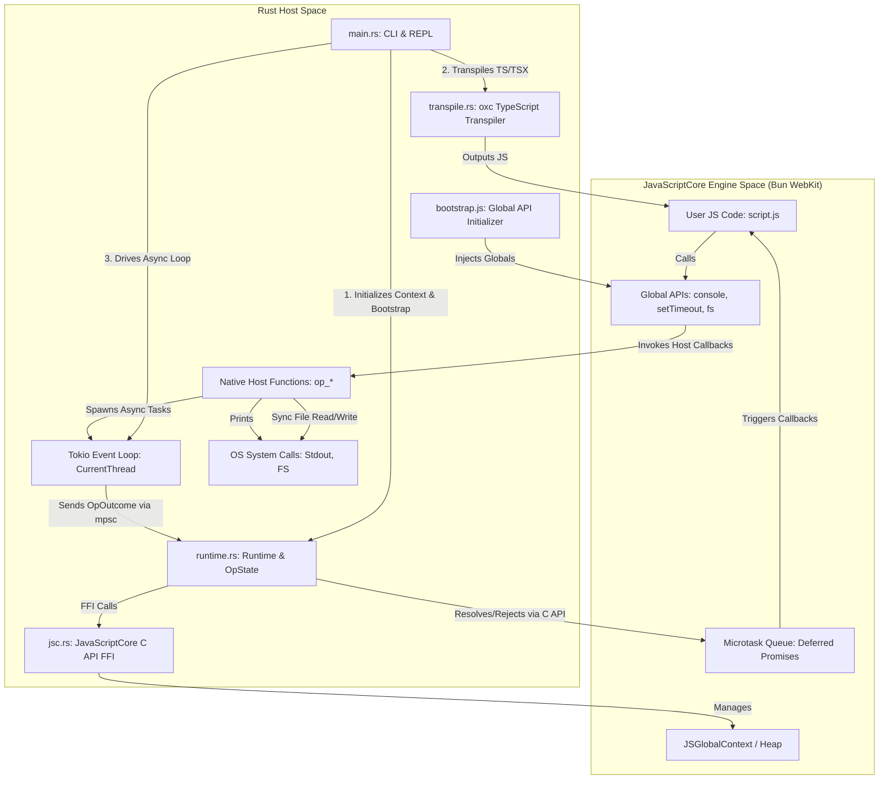

# Custom JS/TS Runtime

A lightweight, custom JavaScript & TypeScript runtime built in Rust, powered by **JavaScriptCore** (Bun's `oven-sh/WebKit` engine build), asynchronous task scheduling (via `tokio`), and fast TypeScript type-stripping (via `oxc`).

---

## 🏗️ Architectural Overview

The runtime operates across two major execution contexts: the **Rust Host Space** (compiled binary) and the **JavaScriptCore Engine Space** (embedded VM/JIT). The interaction between these spaces, including the TypeScript transpiler pipeline, is illustrated below:



---

## ⚙️ How it Works Under the Hood

### 1. Transparent TypeScript Support (`oxc`)
JavaScriptCore executes standard JavaScript and does not natively understand TypeScript type annotations. To support TypeScript (`.ts` and `.tsx`):
*   [src/transpile.rs](file:///c:/Users/mathi/projects/runtime/src/transpile.rs) parses the source using the **Oxc** compiler (`oxc::parser`, `oxc::semantic`, `oxc::transformer`, and `oxc::codegen`).
*   It performs **type-stripping transpilation**, removing type annotations, interface declarations, and generics, and emits standard JavaScript.
*   This transpiled JavaScript is evaluated directly inside the JavaScriptCore global context.
*   In the REPL, every entered line is transpiled through `oxc` on-the-fly, allowing TypeScript syntax directly in the interactive shell.

### 2. Engine Initialization & Bootstrapping (`JavaScriptCore`)
When the runtime starts, [src/runtime.rs](file:///c:/Users/mathi/projects/runtime/src/runtime.rs) creates a `Runtime` instance backed by Bun's static build of WebKit's JavaScriptCore ([src/jsc.rs](file:///c:/Users/mathi/projects/runtime/src/jsc.rs)):
*   `JSGlobalContextCreate` initializes a fresh JavaScriptCore VM and `JSGlobalContextRef`.
*   The host constructs a plain JS object containing native C-ABI callback functions created via `JSObjectMakeFunctionWithCallback`.
*   [src/bootstrap.js](file:///c:/Users/mathi/projects/runtime/src/bootstrap.js) is evaluated as a function expression and invoked with that `ops` object, wiring up `globalThis.console`, `globalThis.setTimeout`, and `globalThis.fs` without leaking raw op bindings onto the global scope.
*   `JSGlobalContextSetUnhandledRejectionCallback` tracks unhandled promise rejections so they surface as errors.

### 3. Native Host Bindings (`src/jsc.rs` & `src/runtime.rs`)
Native operations are implemented as `extern "C"` callbacks matching `JSObjectCallAsFunctionCallback`:
*   **Synchronous Ops**: `op_custom_print`, `op_fs_read_file_sync`, and `op_fs_write_file_sync` convert `JSValueRef` arguments into Rust strings, perform the operation immediately, and return a `JSValueRef` (or populate the `exception` out-pointer on failure).
*   **Asynchronous Ops**: `op_sleep`, `op_fs_read_file_async`, and `op_fs_write_file_async` create a JS Promise via `JSObjectMakeDeferredPromise`, protect the `resolve` and `reject` function objects with `JSValueProtect`, store them in a thread-local `pending` map, and spawn the I/O future onto Tokio.

### 4. The Event Loop (`tokio`)
JavaScriptCore is single-threaded on the host thread, while asynchronous timers and file I/O are driven by **Tokio**:
*   When a spawned Tokio task finishes, it sends its `(id, OpOutcome)` over an unbounded `mpsc` channel back to the `Runtime`.
*   `Runtime::run_event_loop` awaits completions on the main thread, looks up the protected `resolve`/`reject` callbacks, invokes them via `JSObjectCallAsFunction` (which drains resulting microtasks inside JSC), and unprotects the handles via `JSValueUnprotect`.
*   The loop exits automatically once all pending async operations have settled.

### 5. Interactive REPL State
The Read-Eval-Print Loop (REPL) keeps a single `Runtime` instance alive across lines:
*   Each line is transpiled as a classic script (`SourceType::ts().with_script(true)`) and evaluated via `JSEvaluateScript` against the persistent global context, preserving top-level bindings (`let`, `const`, `var`, `function`) across turns.
*   Non-`undefined` completion values are converted via `JSValueToStringCopy` and printed to stdout, followed by `run_event_loop().await` to drain any timers or async I/O started by the expression.

### 6. Linking Bun's Prebuilt WebKit (`build.rs` & `mimalloc`)
*   [build.rs](file:///c:/Users/mathi/projects/runtime/build.rs) links statically against `JavaScriptCore`, `WTF`, `bmalloc`, and bundled ICU libraries from `vendor/bun-webkit` (or `BUN_WEBKIT_DIR`), and [`.cargo/config.toml`](file:///c:/Users/mathi/projects/runtime/.cargo/config.toml) enables `+crt-static` on Windows MSVC to match Bun's `/MT` static CRT build.
*   Because Bun's JSC build delegates allocations to mimalloc v3 without bundling it, the crate links `libmimalloc-sys` and provides the `mi_on_thread_idle` symbol in [src/mimalloc_shim.rs](file:///c:/Users/mathi/projects/runtime/src/mimalloc_shim.rs).

---

## 🚀 Quick Start

### Prerequisites
1. Make sure you have Rust and Cargo installed.
2. Download Bun's prebuilt JavaScriptCore libraries into `vendor/bun-webkit` (or set `BUN_WEBKIT_DIR`):
   ```powershell
   ./scripts/fetch-webkit.ps1
   ```

### Commands

1.  **Launch the REPL (No arguments)**:
    ```powershell
    cargo run
    ```
2.  **Execute a JS/TS File**:
    ```powershell
    cargo run -- <path_to_js_or_ts_file>
    ```
    Examples:
    ```powershell
    cargo run -- tests/integration.js
    ```
    ```powershell
    cargo run -- tests/ts_test.ts
    ```
    ```powershell
    npm install
    cargo run -- tests/hono_ws_test.ts
    ```
3.  **Check CLI usage & help options**:
    ```powershell
    cargo run -- --help
    ```
