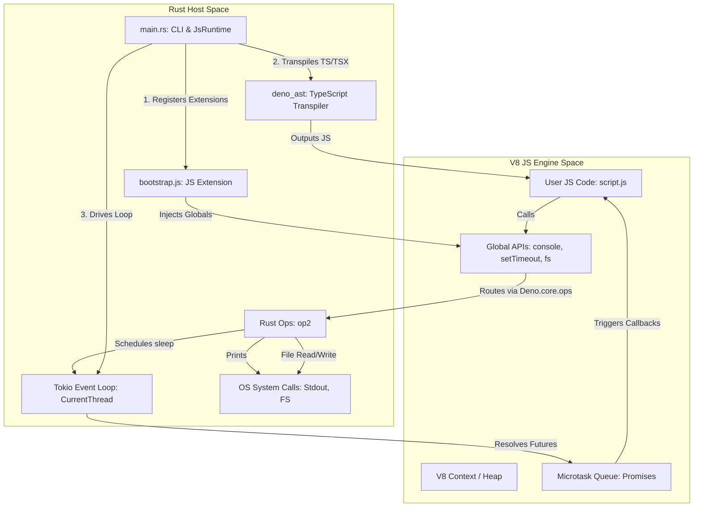

# Custom JS/TS Runtime

A lightweight, custom JavaScript & TypeScript runtime built in Rust, powered by the Google V8 engine (via `deno_core`), asynchronous task scheduling (via `tokio`), and transparent type-stripping (via `deno_ast`).

---

## 🏗️ Architectural Overview

The runtime operates across two major execution contexts: the **Rust Host Space** (compiled binary) and the **V8 JS Engine Space** (embedded interpreter/compiler). The interaction between these spaces, including the TypeScript transpiler pipeline, is illustrated below:



---

## ⚙️ How it Works Under the Hood

### 1. Transparent TypeScript Support (`deno_ast`)
V8 is purely a JavaScript engine and has no understanding of TypeScript types. To support TypeScript:
*   When executing a `.ts` or `.tsx` file, the runtime parses the file using Deno's `deno_ast` crate (which utilizes SWC under the hood).
*   It performs **type-stripping transpilation**, removing type annotations, interface declarations, and generics, returning valid, standard JavaScript.
*   This transpired JavaScript is passed directly to the V8 context for compilation and execution.
*   In the REPL, all entered lines are parsed and transpiled as TypeScript on-the-fly, allowing you to run type annotations directly in the terminal.

### 2. Engine Initialization & Bootstrapping
When you launch the runtime, the Rust host initializes a `JsRuntime` instance. Under the hood:
*   V8 creates an **Isolate** (an independent instance of the V8 runtime representing a single thread) and a **Context** (a global execution scope containing standard built-ins).
*   During initialization, the custom **Extension** is loaded. This embeds and evaluates [src/bootstrap.js](file:///c:/Users/mathi/projects/runtime/src/bootstrap.js) directly inside V8 before the user's script runs.
*   The bootstrap script accesses raw Rust bindings exposed at `Deno.core.ops` and registers clean, standard JavaScript APIs onto `globalThis` (e.g. creating the `console`, `setTimeout`, and `fs` objects).

### 3. Bridge Bindings: Rust Ops (`#[op2]`)
To allow JavaScript/TypeScript to do useful things like file I/O or printing, we define **Ops** in Rust using `deno_core`'s `#[op2]` macros.
*   **Fast Ops (`#[op2(fast)]`)**: Used for simple, synchronous calls that do not allocate memory or return complex objects (like [op_custom_print](file:///c:/Users/mathi/projects/runtime/src/main.rs#L11) or [op_fs_write_file_sync](file:///c:/Users/mathi/projects/runtime/src/main.rs#L31)). These bypass V8's slow call-boundary path for near-native performance.
*   **Slow/Async Ops (`#[op2]`)**: Used when returning complex types (like string buffers) or executing asynchronously (like [op_sleep](file:///c:/Users/mathi/projects/runtime/src/main.rs#L19) or [op_fs_read_file_async](file:///c:/Users/mathi/projects/runtime/src/main.rs#L37)).

### 4. The Event Loop (`tokio`)
V8 is single-threaded and does not natively support async operations like timers. The event loop is managed by Rust's **Tokio scheduler**:
*   The Tokio runtime is configured in single-threaded mode (`flavor = "current_thread"`) to align with V8's single-threaded architecture safely.
*   When `setTimeout` is called in JS/TS, it fires the async [op_sleep](file:///c:/Users/mathi/projects/runtime/src/main.rs#L19) Rust function. This creates a future that sleeps on the Tokio thread pool.
*   Once the Tokio timer future resolves, it marks the corresponding JavaScript Promise as resolved, queuing the JS callback in the V8 Microtask queue.
*   `JsRuntime::run_event_loop` continuously polls and drives these futures to completion, ensuring the runtime process does not exit until all async tasks are finished.

### 5. Interactive REPL State
The Read-Eval-Print Loop (REPL) keeps a single `JsRuntime` running:
*   As the user inputs lines, the runtime evaluates them. Because V8 maintains heap variables within the active Context, declarations (`let`, `const`, `var`) persist naturally.
*   Every evaluated statement returns a V8 handle (`v8::Global`). The Rust Host temporarily enters a `HandleScope` and `ContextScope` to access the value, convert it to a Rust string via `to_rust_string_lossy`, and print it to standard output.

---

## 🚀 Quick Start

### Prerequisites
Make sure you have Rust and Cargo installed.

### Commands

1.  **Launch the REPL (No arguments)**:
    ```powershell
    cargo run
    ```
2.  **Execute a JS/TS File**:
    ```powershell
    cargo run -- <path_to_js_or_ts_file>
    ```
    Examples:
    ```powershell
    cargo run -- tests/integration.js
    ```
    ```powershell
    cargo run -- tests/ts_test.ts
    ```
3.  **Check CLI usage & help options**:
    ```powershell
    cargo run -- --help
    ```
